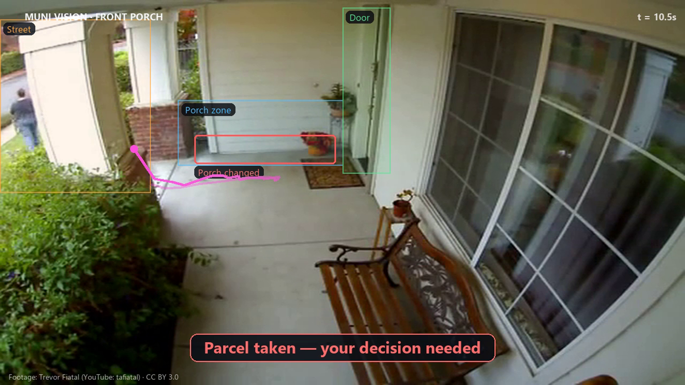
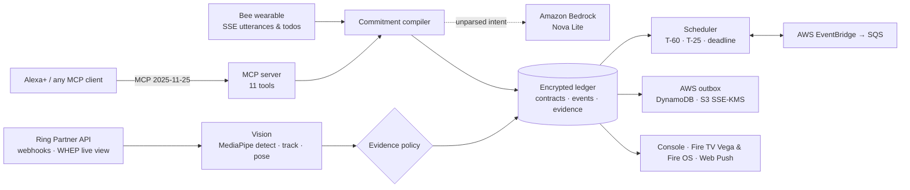

<div align="center">

# Muni

### Promises, kept. Proven by reality.

Muni hears the promises you make in passing, turns each one into a living contract, watches the real world for proof, and nudges you while there's still time — across **Alexa+**, **Ring**, **Bee** and **Fire TV**.

[](https://github.com/vivekyarra/Muni/actions/workflows/ci.yml)


**[Try Muni live](https://100-49-183-59.sslip.io)** · **[▶ Watch the video](https://youtu.be/bQ7NeIiHXAQ)** · [Judge in 5 minutes](docs/judge-runbook.md) · [How it works](#how-it-works) · [Amazon tech](#built-on-amazon) · [Quick start](#quick-start)


</div>

---

## The problem

Every assistant can set a reminder. None of them know whether you actually did the thing.

A reminder firing isn't a call made. A courier's *"delivered"* isn't a parcel on your porch. A model returning `completed=true` isn't proof. So the promises that matter most — *"I'll call Mom tonight"*, *"I'll pick up the medicine"*, *"I'll be at the teacher meeting at 4"* — quietly slip, and nobody notices until it's too late.

## The solution

Muni is a **commitment keeper for the home**. You never say "set a reminder":

1. **It listens** (Bee, Alexa+, or typed) and compiles every promise into a typed contract — who it's for, when it's due or what triggers it, how it can be proven, and whether it repeats.
2. **It watches reality** through Ring cameras, Fire TV and your own confirmations, and closes a promise **only** when the evidence meets that promise's policy.
3. **It intervenes early** — a quiet nudge at T-60, an actionable escalation at T-25 only if you're not on it, a private check at the door, a 08:00 briefing — then records the outcome honestly.

## What makes Muni different

> **Commitment → evidence → closure.** Not commitment → reminder.

- **Verified, not assumed.** Every *done* links to evidence that satisfies a per-promise policy: a pose-counted workout, a camera-observed deposit, a corroborated meeting, or your own confirmation — which is always shown as *"Confirmed by you"*, never as sensor proof.
- **Honest under uncertainty.** "Not seen" never becomes "forgot". A spoken *"I already did it"* moves a promise to *awaiting your confirmation*, not to done. A parcel leaving the porch is a question — *was this authorized?* — not an accusation.
- **Humans decide consequential actions.** Muni preserves a hash-chained evidence packet; nothing leaves the house unless you approve the exact packet and destination.
- **One brain, every surface.** Alexa+ asks over MCP, Ring sees, Bee hears, Fire TV gates the reward — all on one durable ledger, with AWS keeping the schedule.

## A day with Muni

| Time | What happens | Device |
|---|---|---|
| **08:15** | Breakfast chat: *bring cold drinks tonight · call your sister before 6 · cover the teacher meeting at 4 · 15 squats before TV*. Four contracts appear; none are verified. | Bee · Alexa+ |
| **14:10** | Courier says *"left at your door"*. Muni checks the camera — a real deposit starts a persistent porch watchdog; a false delivery claim is flagged as a delivery mismatch. | Ring |
| **15:00 / 15:35** | Silent prep for the teacher meeting, then an actionable alert because you weren't preparing. The meeting closes only when attendance evidence arrives. | AWS EventBridge · phone |
| **16:30** | Someone carries the parcel toward the street. Muni saves the clip, crop and SHA-256 manifest and asks: *family, or report?* | Ring · Fire TV |
| **19:45** | You walk up without the drinks. A private *"check before you go in"* — no accusation. | Ring · phone |
| **20:30** | Fire TV's **Reality-Lock**: the camera counts 15 real squats with MediaPipe; the 15th unlocks your evening. | Fire TV · Ring |

Beyond the canonical day, Muni handles everyday life: *"pay the electricity bill by Friday"*, *"call Amma at 7"*, *"take out the bins every Monday"*, *"remind me to take medicine after lunch"*, a family member's *"can you pick up groceries?"* (held for your OK), recurring series and a morning briefing.

## Screens

| Commitment ledger & proof | Evidence & incidents |
|---|---|
|  |  |
| **Reality-Lock studio** | **Alexa+ over MCP** |
|  |  |

## How it works



- **Commitment compiler** — deterministic, explainable parsing first; when the rules find nothing in a sentence that still sounds like an intention, **Amazon Bedrock Nova** reads it and returns validated JSON. Nova can propose a contract but never verify one, and low-confidence readings wait for your OK. Deterministic parsing covers deadlines (*tonight, by 5th, day after tomorrow, in an hour and a half*), triggers (*when I get home, before TV*), recurrence, counterparty and verification method; injection text and negations are refused.
- **Evidence policy** — a contract reaches `VERIFIED` only with policy-matching evidence; terminal states never regress; every transition is an append-only event with one trace ID from utterance to screen.
- **Perception** — Ring WHEP video decoded server-side; MediaPipe EfficientDet + tracking for porch and doorway scenes; MediaPipe Pose for squat cycles, rejecting half reps, frozen frames and loops.
- **Durability** — AES-GCM encrypted SQLite WAL ledger with a leased provider inbox, replicated through a transactional outbox to DynamoDB and S3; every deadline is a real EventBridge schedule.

More: [architecture](docs/architecture.md) · [integrations](docs/integrations.md) · [privacy & security](docs/privacy-security.md)

## Built on Amazon

| | How Muni uses it |
|---|---|
| **Alexa+ (MCP)** | Self-hosted Streamable HTTP MCP server (protocol `2025-11-25`) with 11 tools — `compile_ambient_commitment`, `spawn_watchdog_subagent`, `evaluate_deadline_escalation`, `dispatch_police_evidence_dossier`, `bridge_ring_camera_to_firetv` and read-only state tools. A web Alexa+ experience (voice or typed) drives it over real JSON-RPC and shows every tool call. |
| **Ring** | Partner API: device discovery, capabilities, event history, signed webhooks, and WHEP live view decoded server-side into the Reality-Lock studio — verified live on the Ring Developer Playground device. |
| **Bee** | Developer API: live SSE stream (`new-utterance`, `todo-created`) and todo backfill compiled straight into contracts — verified on a real Bee device. |
| **Fire TV** | A React Native for **Vega OS** app running on the Vega Virtual Device, and a **Fire OS** APK with full D-pad navigation (tested on every push in CI). |
| **AWS** | **Amazon Bedrock (Nova Lite)** reads promises the rules can't parse (*"the car needs servicing this weekend, I'm on it"*) · CloudFormation · EC2 + SSM · DynamoDB · S3 (SSE-KMS) · EventBridge Scheduler · SQS + DLQ · Secrets Manager · CloudWatch. |

## Try it in 5 minutes

**https://100-49-183-59.sslip.io** — press **Try Muni live** (no account needed; every visitor gets a private copy of the day), then **Run the full day**, then follow the [judge runbook](docs/judge-runbook.md). Point any MCP client at `https://100-49-183-59.sslip.io/mcp/`.

## Quick start

Requires Python 3.12+ with [uv](https://docs.astral.sh/uv/), Node.js 22.12+ and npm. Works on Linux, macOS and Windows (Git Bash).

```bash
git clone https://github.com/vivekyarra/Muni.git && cd Muni
./scripts/setup-local.sh      # Python deps, pinned MediaPipe models, console build
./scripts/start-local.sh      # http://127.0.0.1:8080
./scripts/access.sh           # local judge / owner passwords
```

Connect real devices by filling `.env` (see `.env.example`):

```bash
RING_ACCESS_TOKEN=... uv run --extra ring-video python scripts/ring-live-probe.py   # Ring Developer Playground token
BEE_TOKEN=...         uv run python scripts/bee-live-probe.py --seconds 120          # Bee device token
uv run python scripts/firetv-emulator-check.py --boot --record                       # Fire OS APK D-pad journey
```

Deploy your own HTTPS stack on AWS: [infra/aws/README.md](infra/aws/README.md).

## Validation

| | |
|---|---|
| **Tests** | 280 backend tests (domain, security, MCP compliance, real-video vision, pose, privacy, AWS via Moto) · 7 Playwright journeys · Android TV emulator D-pad journey · container replay — all in CI on every push |
| **Scenario coverage** | All 24 canonical and adversarial fixtures machine-checked — [fixture matrix](docs/evidence/fixture-matrix.md) |
| **Live Ring** | 176 distinct 720p WHEP frames decoded; live relay into Reality-Lock — [probe](docs/evidence/ring-live-probe.json) · [studio](docs/evidence/ring-live-studio.json) |
| **Live AWS** | T-60 / T-25 / deadline fired by EventBridge within one second of schedule — [evidence](docs/evidence/aws-live-escalation.json) |
| **Vision** | 10/10 real licensed doorstep & CCTV clips classified correctly — [results](docs/evidence/scene-vision.json) |
| **Pose** | 15/15 squats unlock; 14 stays locked; half, frozen and looped reps rejected — [results](docs/evidence/pose-15-fixture.json) |

## Project structure

```text
apps/
  mcp-orchestrator/        FastAPI backend, MCP server, ledger, compiler, vision, AWS runtime  (Python)
  judge-godmode-console/   Web console: Mission control, ledger, studio, Alexa+, evidence       (React + TS)
  firetv-vega-hud/         Fire TV app for Vega OS                                             (React Native for Vega)
  firetv-command-hud/      Fire TV app for Fire OS                                             (Android)
  vision-webrtc-engine/    Vision worker entry point
packages/
  physical-contract-schema/                  Shared contract & event schemas
  agent-skills/evidence-backed-commitments/  Open-source Agent Skill (MIT)
  testing-fixtures/                          Licensed real-scene clips and workout videos, with provenance
infra/aws/                 CloudFormation (judge-stack.yaml, template.yaml) and operations guide
scripts/                   setup, start, live probes, deploy, emulator and UI checks
tests/                     Playwright journeys and Fire TV device reports
docs/                      architecture, integrations, privacy, judge runbook, product feedback, evidence
```

## Open source

The rules and compiler behind Muni are published as an Agent Skill for Amazon's community skills collection: [AmazonAppDev/devices-agent-skills#16](https://github.com/AmazonAppDev/devices-agent-skills/pull/16) — source in [`packages/agent-skills/evidence-backed-commitments`](packages/agent-skills/evidence-backed-commitments).

## Privacy & safety

Explicit consent before any collection, per-camera exclusions and privacy masks, adjustable retention with physical deletion, provider disconnect and full household deletion. No face identification. No autonomous police reports — the local receiver records an approved dispatch and sends nothing. In-app reward gate only; Muni never controls other apps. Details: [privacy & security](docs/privacy-security.md).

## Roadmap

- Native Alexa+ skill connection to the MCP server
- Longer-lived Ring tokens for always-on porch watching
- Household sharing: promises made *to* you, with their own proofs
- More verifiable actions: bins at the curb, medication taken, homework done

## Feedback for Amazon

What worked, what didn't and what we'd ask for, per tool: [product feedback](docs/product-feedback.md) · [friction log](docs/friction-log.md).

## License

[MIT](LICENSE)
