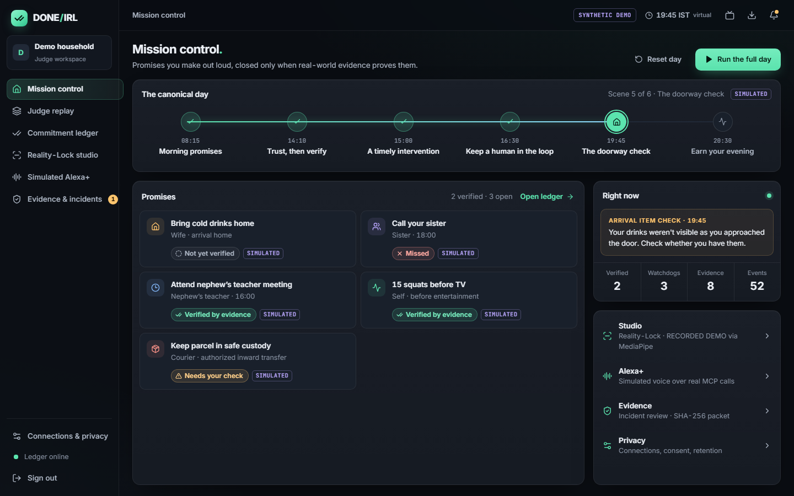
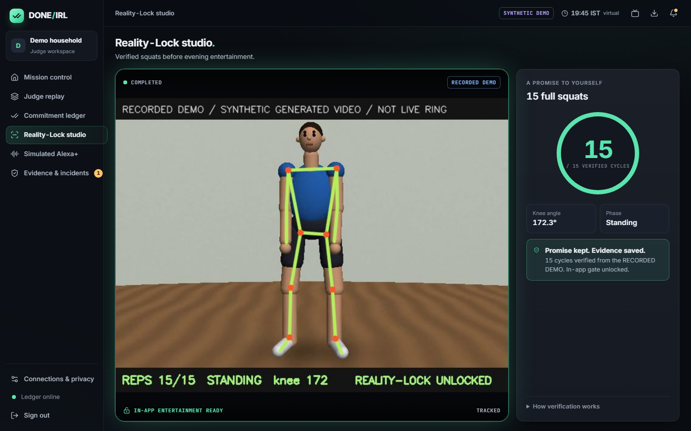
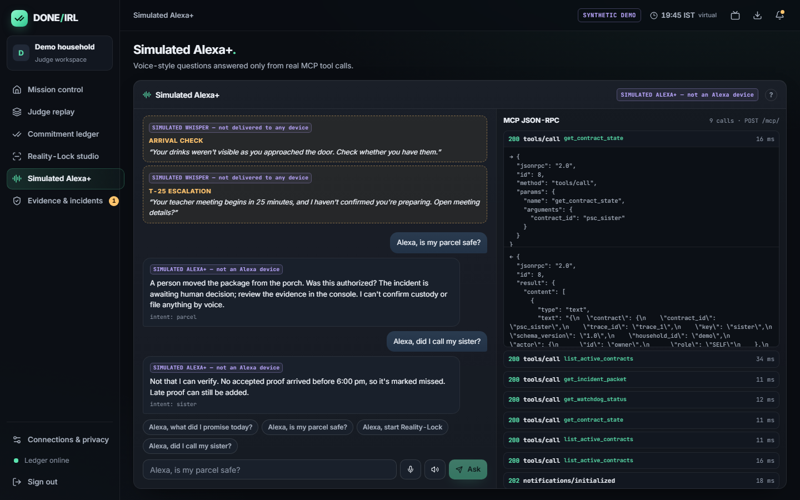
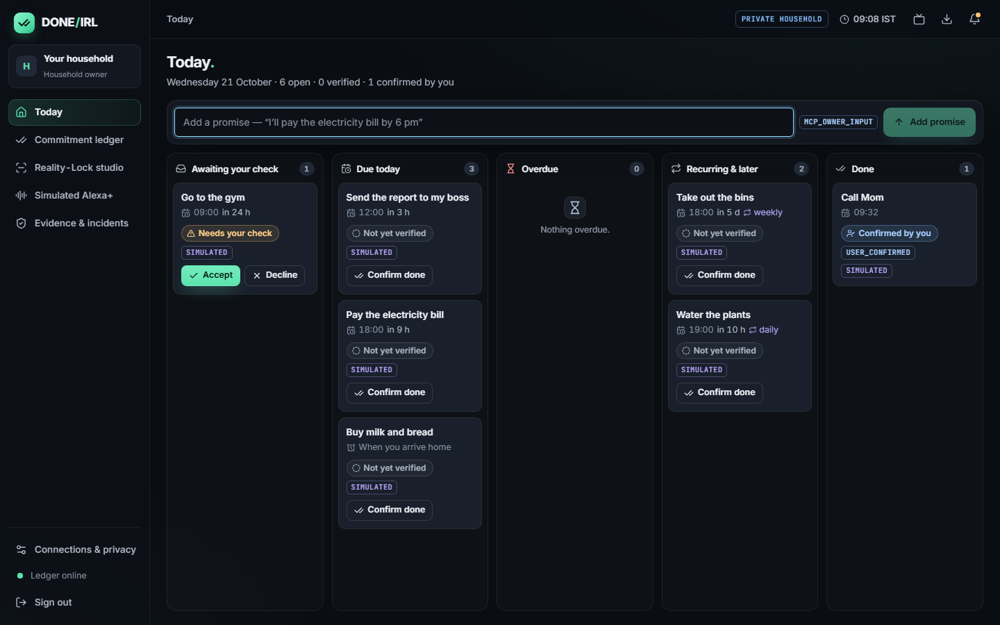

# DONE/IRL

**APIs lie. Reality doesn’t.** DONE/IRL is a commitment daemon for the home. It hears the promises you make in passing, turns each one into a durable *physical state contract*, watches for real evidence, nudges you early (T-60 quietly, T-25 only if you are not on it), and refuses to call anything **done** until the evidence says so.

- **Everyday promises, no reminder commands.** "I'll pay the electricity bill by Friday", "I'm going to call Mom tonight", "I'll take out the bins every Monday", "Can you pick up groceries?" become typed contracts with deadlines or triggers (arriving home, before TV), recurring series, and a private 08:00 briefing. Saying "I already called her" is a lead, not proof: the contract waits for your confirmation (`USER_CONFIRMED`) or sensor evidence.
- **Alexa+ (MCP).** A self-hosted Streamable HTTP MCP server (`2025-11-25`) with 11 tools, plus a clearly labelled *simulated Alexa+* voice panel that calls those tools over real JSON-RPC.
- **Ring-style evidence.** Deposit vs fake delivery, porch removal, inward pickup and the "drinks not visible" arrival check run on real decoded video (licensed recorded footage) through MediaPipe object detection and tracking, with hash-chained evidence and a human-approval gate before any report.
- **Fire TV Reality-Lock.** A D-pad TV app; 15 squats counted by MediaPipe Pose unlock the in-app entertainment gate (14 stays locked).
- **AWS.** Live on DynamoDB, S3 (SSE-KMS), EventBridge Scheduler, SQS and CloudWatch.

> **Honest status:** the product works end to end with real cloud infrastructure and real video processing. Live Bee data, a live Ring camera, a physical Fire TV / Vega device run and the public video are still outstanding, so the original-vision release is **NOT COMPLETE**. Every surface carries a source label (`LIVE_VERIFIED`, `SIMULATED_VERIFIED`, `REAL_RECORDED_STOCK`, `RECORDED DEMO`, `BLOCKED`). See [integration status](docs/integration-status.md), [traceability](docs/requirements-traceability.md) and the [acceptance report](docs/acceptance-report.md).

## Try it online (judges)

**https://100-49-183-59.sslip.io** — HTTPS, hosted on AWS until the end of judging. Sign in as `demo-admin` with the password from the Devpost testing instructions (not stored in this repository). The demo household replays one canonical day on a virtual clock and can be reset at any time; the `owner` household runs on wall-clock time.

1. **Mission control → Run the full day**, or step through the six scene buttons (08:15 promises → 14:10 courier → 15:00/15:35 escalation → 16:30 removal → 19:45 arrival → 20:30 Reality-Lock).
2. **Judge replay** lets you pick branches: fake vs real deposit, family pickup vs report review, visible vs empty vs occluded hands, and the `real_*` branches that run on licensed real footage.
3. **Studio → Play RECORDED DEMO through MediaPipe** streams a 15-squat video through the real pose engine; watch 14/15 stay locked and 15/15 unlock.
4. Talk or type to the **SIMULATED ALEXA+** panel ("Alexa, what did I promise today?") and watch the MCP JSON-RPC log.
5. Point any MCP client at `https://100-49-183-59.sslip.io/mcp/` with the session token as a Bearer header.



| Reality-Lock studio (RECORDED DEMO through MediaPipe) | Simulated Alexa+ over real MCP calls | Owner "Today" view (wall clock) |
|---|---|---|
|  |  |  |

Evidence: [AWS deployment](docs/evidence/aws-deployment.json) · [live MCP + EventBridge](docs/evidence/aws-mcp-scheduler.json) · [real-scene vision](docs/evidence/scene-vision.json) · [pose 15-rep fixture](docs/evidence/pose-15-fixture.json) · [TV emulator walkthrough](docs/evidence/firetv/walkthrough.mp4) · [CI](docs/evidence/ci-runs.md)

## Run locally

Requires Python 3.12+ via [uv](https://docs.astral.sh/uv/), Node.js 22.12+ (24 recommended) and npm. Works on Linux, macOS and Windows (Git Bash). Linux needs `libgl1 libglib2.0-0 libgles2 libegl1` for OpenCV/MediaPipe. No camera, cloud account or device token is required.

```bash
./scripts/setup-local.sh
./scripts/start-local.sh
```

The service listens on port 8080 and serves the built frontend and API together. Run `./scripts/access.sh` privately to read the generated `demo-admin` and `owner` passwords; never paste them into issues, videos or logs. For frontend development, run the backend and `npm run dev` separately.

## Connect real devices (owner)

```bash
# Bee: real wearable data (token from `bee login` / Bee developer settings)
BEE_TOKEN=... uv run python scripts/bee-live-probe.py --seconds 120
# Ring: Developer Playground token (~30 min lifetime)
RING_ACCESS_TOKEN=... uv run --extra ring-video python scripts/ring-live-probe.py
# Fire OS APK on an Android TV emulator (D-pad walkthrough + screenshots)
uv run python scripts/firetv-emulator-check.py --boot --record
```

Probe reports are redacted (counts, shapes, hashes only). Live Bee events feed the owner household; unattributed speech is held for confirmation unless `BEE_SELF_SPEAKERS` names the wearer's speaker label.

## The canonical day, step by step

1. Sign in as `demo-admin`. Choose **Run the full day** in Mission control.
2. Four morning utterances compile into four durable contracts. Nothing starts verified.
3. The synthetic camera sees the parcel deposited; one persistent PorchWatchdog starts. Custody stays pending.
4. Teacher T−60/T−25 jobs execute; a separate authorized synthetic meeting transcript verifies attendance.
5. A removal opens a human-review incident with real generated snapshots and SHA-256 hashes. It sends no police report.
6. Arrival with drinks not visible requests a user check. It never proves the drinks are absent.
7. Studio processes generated marker pixels into landmarks and 15 complete movement cycles. The in-app gate opens. This is synthetic geometry, not a certified human fitness detector.

Use **Judge replay** to choose fake delivery, engaged meeting preparation, authorized family pickup, a parcel that remains, visible drinks, or occluded hands. Reset before rewinding or changing an already played branch. Inspect contract provenance, event JSON, schedules, and evidence. The sister call stays unresolved until independently supplied proof. Browser tabs and the TV preview read the same database.

## Verification

```bash
uv run ruff check apps/mcp-orchestrator
uv run pytest -q --junitxml=artifacts/backend-results.xml
npm run build
# Uses /usr/bin/chromium when present, otherwise Playwright's Chromium. E2E_PORT overrides port 8091.
npm run test:e2e
./scripts/verify-release.sh  # expected nonzero while original-vision gates are unresolved
```

Tests exercise exact scheduling, durable restart, evidence tampering, household isolation, owner approval, compiler ambiguity, source failures, pixel-based synthetic vision, fourteen-versus-fifteen reps, browser journeys, and an external MCP SDK client over TCP. A green engineering CI is distinct from a complete product release. Generated logs, screenshots, databases, caches and APKs stay out of the source tree history; CI publishes test artifacts separately.

## Surfaces and modules

| Module | Implementation |
|---|---|
| `apps/mcp-orchestrator` | FastAPI, official MCP SDK Streamable HTTP, SQLite WAL, deterministic domain policies, backend adapters |
| `apps/vision-webrtc-engine` | Vision worker and source documentation; shared pixel/pose engine in orchestrator package |
| `apps/firetv-command-hud` | Native Fire OS Android TV shell; shared authenticated four-view web HUD |
| `apps/judge-godmode-console` | React + TypeScript judge console, companion inbox, keyboard TV preview |
| `packages/physical-contract-schema` | Shared TypeScript contracts and generated JSON schemas |
| `packages/testing-fixtures` | Synthetic fixtures, generated 15-squat videos and licensed real-scene clips with provenance |
| `packages/agent-skills/evidence-backed-commitments` | Open-source Agent Skill (MIT) packaging the commitment compiler and never-fake-done rules |

Fire OS build/install and runtime validation are described in [TV instructions](apps/firetv-command-hud/README.md). Web TV mode is explicitly a preview. The primary candidate track is Alexa+ via compliant MCP/simulated orchestration, pending actual eligibility review and recorded proof; other track claims require their device evidence.

## Simulated Alexa+ experience

There is **no real Alexa device or Alexa+ account connection**. Under the hackathon's simulated-Alexa+ entry route, the **Judge replay** page includes a panel labeled **SIMULATED ALEXA+ — not an Alexa device**:

- Speak (browser Web Speech API, where available) or type, e.g. "Alexa, what did I promise today?", "Alexa, is my parcel safe?", "Alexa, start Reality-Lock", "Alexa, did I call my sister?", "Alexa, report it to the police", "Alexa, are my devices connected?", "Alexa, remember I'll call my sister before 6 PM".
- A deterministic router (fixed rules, no LLM) maps each request to MCP tool calls made from the browser as real JSON-RPC to the same-origin, authenticated `/mcp/` endpoint (`initialize` → `tools/call`). The panel's right rail shows every request/response.
- Answers are built only from tool results and are read aloud with `speechSynthesis`; each carries the simulation badge. T-25 escalation and arrival-check alerts from the shared ledger appear as a **SIMULATED WHISPER — not delivered to any device**, using the spec 5.4 copy.
- Voice cannot verify a promise or file a report: `dispatch_police_evidence_dossier` always returns `DENIED` (audited) and the live Ring→Fire TV bridge reports `BLOCKED` in demo mode.

External MCP proof (official Python SDK client over real HTTP, plus the MCP Inspector CLI):

```bash
uv run --extra ring-video --extra aws python scripts/mcp-external-client.py --inspector
# -> docs/evidence/mcp-external-client.json, docs/evidence/mcp-inspector-cli.json (credentials redacted)
```

## Safety and privacy

No browser receives a Bee/Ring/AWS credential. All state and evidence routes require household-scoped authentication. API writes require an idempotency key. Cookies are HttpOnly/SameSite; HTTPS enables Secure cookies. The server validates origins and rate-limits commands. Live pilot startup requires an explicitly provisioned encryption key, HTTPS origins and strong owner-only credentials; actual integration/runtime certification remains pending. Simulated incident approval is bound to the exact manifest and destination; a tool’s `human_confirmed_boolean` cannot authorize dispatch. There is no official police adapter or cross-app TV lock.

See [architecture](docs/architecture.md), [privacy](docs/privacy-security.md), [deployment](docs/deployment.md), [judge runbook](docs/judge-runbook.md), and the [original product specification](docs/product-spec.md).

## Repository workflow

Work is developed on feature branches and merged to `main` only after CI passes. CI must pass on the exact release commit before promotion to `main`. Credentials, local outputs, vendor directories, APKs and generated build bundles are ignored. Publication, third-party device registration, and submission video uploads need owner-controlled accounts and are not inferred from a passing local test.


## Live runtime and AWS pilot

The optional runtime includes an encrypted durable provider inbox, wall-clock deadline worker, documented Ring webhook signatures, a backend WHEP decoder/MediaPipe/JPEG relay, and optional AWS outbox replication, DynamoDB projections, private S3 evidence, EventBridge Scheduler/SQS and hash-checked snapshot recovery. New live households require explicit consent; no demo administrator exists in this mode. Actual Bee/Ring/Alexa/Fire TV account and device acceptance is still outstanding.

See [AWS provisioning and operations](infra/aws/README.md), [current architecture](docs/architecture.md), [integration proof](docs/integration-status.md) and [public reference attribution](docs/public-references.md). Install optional runtime dependencies with `uv sync --frozen --extra ring-video --extra aws`; run backend checks with the same extras to exercise real WebRTC codec loopback. Build the live container with `--build-arg ENABLE_LIVE_RUNTIME=true`. Local AWS emulation and template lint are not evidence of an actual deployment.
