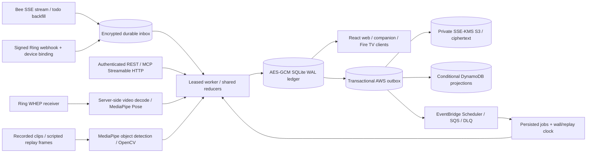

# Architecture

Every surface consumes the same household-scoped state. The official MCP SDK mounts Streamable HTTP at `/mcp/`; REST and MCP share the commitment compiler, authorization, evidence policies and transactional storage. State, event audit, command deduplication responses, artifact bytes and AWS outbox inserts commit in one SQLite `BEGIN IMMEDIATE` transaction. Conflicting owner revisions and reused idempotency keys fail explicitly.

## Clocks and source provenance

The guided household runs on a persisted **replay clock** with administrator-only replay controls. Owner households run on the **wall clock**, with owner-only accounts, a provisioned encryption key and HTTPS; collection starts disabled until the owner enables it. A one-second worker reconciles durable deadline jobs, skips stale alert tiers and never converts a missed deadline into verification. Every observation carries its source label (live, recorded or scripted replay) end to end.

Provider events enter a deduplicated, encrypted inbox. A receipt is claimed with a sixty-second lease; its reducer mutations and acknowledgement commit together, and a crash recovers the lease. Permanently malformed events enter a visible dead state; retryable failures back off with bounded attempts. Consent revocation cancels pending work and stops camera processing. Bee cursors advance only after a receipt is durable. The Bee normalizer mirrors the event shapes of the official bee-cli and ignores unknown envelopes rather than guessing; it is verified against a live Bee device ([evidence](evidence/bee-live-verification.md)).

Ring webhook HMAC verification follows the documented **`X-Signature: sha256=<HMAC(raw_body)>`** contract. Account and device mappings are provisioned server-side. Provider retries use durable receipt identities; known Ring observation IDs and Bee utterance IDs also survive snapshot recovery. By design, a motion notification proves delivery of a notification only, never parcel deposit, removal, attendance or exercise.

## Evidence, video and TV

Household state, command responses, inbox payloads and media bytes are encrypted with AES-256-GCM; associated data binds each ciphertext to its household and record identity. The ledger key is stored separately with owner-only permissions. Artifact SHA-256 hashes and canonical manifest chains detect modification (integrity, not a claim of legal admissibility). Expired artifact bytes are physically deleted and manifest tombstones retained. A missing key, damaged ciphertext or wrong identity fails closed.

The Ring WHEP path checks camera authorization and video capability, gathers receive-only ICE, negotiates through the backend, decodes frames server-side and runs a SHA-pinned MediaPipe Pose model on each one. Browser and TV clients receive household-authenticated JPEGs with skeleton overlays, never upstream SDP, session URLs or provider credentials. This path ran live against the Ring Developer Playground device: 157 frames decoded and 46 annotated frames relayed into the Reality-Lock studio ([evidence](evidence/ring-live-studio.json)). Frame hashes prevent repeated-frame counting; session limits, camera loss, low visibility, asymmetric form, partial cycles and pauses cannot bypass the 15-cycle gate. A camera reconnect preserves the verified count while resetting an incomplete phase.

Real-footage porch and threshold vision (`scene.py`) runs the pinned MediaPipe EfficientDet-Lite0 detector, ROI change detection and an IoU tracker over ten licensed recorded clips, each returning its expected verdict ([evidence](evidence/scene-vision.json), [sources](public-references.md#real_recorded_stock-scene-vision-fixtures)). The fifteen-rep pose fixture is a generated, labelled recording processed by the same MediaPipe model and reducer as live Ring frames ([evidence](evidence/pose-15-fixture.json)). A deterministic OpenCV marker engine drives the scripted replay scenarios.

Fire TV clients — a Vega OS app on the Vega Virtual Device and a native Fire OS APK — expose ledger, incident, evidence-packet and Reality-Lock views over the same authenticated API. TV session registration is household-scoped and bounded, and MCP can open a camera relay for a registered TV session in the same household. The entertainment gate is a voluntary in-app gate; Muni does not control third-party apps.

## AWS and recovery

The AWS worker publishes encrypted snapshots and media through a transactional outbox. DynamoDB conditional revisions prevent stale snapshots from regressing projections; single-table prefixes make contract, sub-agent, incident, evidence and audit queries explicit. EventBridge Scheduler T-60/T-25/deadline schedules send SQS wake-ups; a local durable reconciler covers missed deliveries, and invalid hints exhaust bounded receives into the DLQ. Cloud synchronization failure degrades readiness and retains work for retry.

Snapshot recovery authenticates key context, snapshot/media hashes and household identity, omits expired media, preserves outbox revision order and refuses to overwrite an existing household. It restores state and media (not sessions, the command cache or in-progress inbox leases; EBS/SQLite backups cover full local recovery). Live initialization refuses to create an empty household when its cloud snapshot already exists.

The judge stack (`infra/aws/judge-stack.yaml`) runs one EC2 reducer behind HTTPS with DynamoDB, S3 SSE-KMS, EventBridge Scheduler, SQS, Secrets Manager and CloudWatch, deployed and smoke-tested over HTTPS ([evidence](evidence/aws-deployment.json)). See the [AWS guide](../infra/aws/README.md).

## Design scope

Muni runs one active writer per ledger volume; the event history is an aggregate that grows with usage. Horizontal scaling, paginated normalized history and automatic failover are outside the current scope. Per-camera exclusion, privacy masks, retention, provider disconnect and household deletion are implemented and tested (`test_privacy.py`); see [privacy and security](privacy-security.md).
