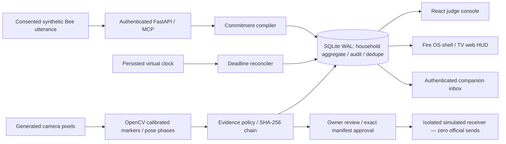

# Architecture

All surfaces consume the same household-scoped ledger. The official MCP SDK mounts Streamable HTTP at `/mcp/` and uses the same compiler and transactional store as REST. Mutations execute under a SQLite `BEGIN IMMEDIATE` transaction; aggregate state, events, command dedupe responses and artifact inserts commit together. Exceptions roll back. Concurrent stale owner actions use revision checks.

The local deployment is one service process with SQLite WAL on a persistent volume. It is a supported local development daemon, not a horizontally scalable AWS implementation. The aggregate includes every contract, deadline job, audit event, consent state, cursor, watchdog and workout phase. A service restart does not discard these records. Demo time advances explicitly and reconciles missed jobs exactly once. It never changes the OS clock. The scheduler evaluates overdue reminders conservatively and records stale jobs instead of issuing misleading “25 minutes away” copy.

Evidence blobs are private SQLite BLOBs. A source hash is computed before storage; records are linked using canonical SHA-256 digests. Every retrieval/export checks bytes. Incident manifests refer to actual available evidence; synthetic snapshots have duration zero; the generated source/annotated removal videos have 150 decoded frames at 10 FPS, with source→derivation links. Explicit authenticated owner approval binds to the exact manifest and the hard-coded demo-only destination. No real police dispatch implementation exists.

The calibrated synthetic detector is deliberately narrow: known colored shapes form parcel/person/drinks observations. It truly processes pixels and motion, but is not YOLO, biometric recognition, or a general scene-understanding model. Human footage requires the optional MediaPipe worker, model provenance, calibration, consent and actual fixture validation. The pose reducer enforces alternating bottom/standing phases, visibility, bilateral consistency, temporal debounce and unique frames. No completion API accepts a rep-count setter.

## Current scale boundary

A household aggregate and command response grow with the demo history. This is suitable for a bounded judge replay, not an unbounded production all-day deployment. Before production: normalized event rows with pagination, bounded dedupe retention, encrypted object storage, a durable worker queue, task leases, AWS policy/IAM review, live adapter reconciliation and load/fault testing are required. The local endpoint intentionally refuses `DEMO_MODE=false` rather than opening unverified production ingestion.
