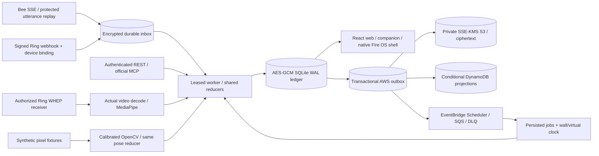

# Architecture

All surfaces consume the same household-scoped state. The official MCP SDK mounts Streamable HTTP at `/mcp/`; REST and MCP share compiler, authorization, evidence policies and transactional storage. State, event audit, command deduplication responses, artifact bytes and AWS outbox inserts commit under one SQLite `BEGIN IMMEDIATE` transaction. Conflicting owner revisions and reused idempotency keys fail explicitly.

## Two clocks and source provenance

The isolated synthetic deployment uses a persisted **virtual clock** and administrator-only replay controls. A separately configured live pilot uses a **wall clock**, owner-only accounts, a provisioned encryption key and HTTPS. New live households have collection disabled. A one-second worker reconciles durable pending deadline jobs, skips stale alert tiers and never converts a missed deadline to verification. Live API reads display current wall time; historical event times stay persisted.

Provider events enter a deduplicated, encrypted inbox. A receipt is claimed with a sixty-second lease. Its reducer mutations and acknowledgement commit together; a crash recovers the lease. Permanent malformed events enter a visible dead state; retryable failures back off with bounded attempts. Consent revocation cancels pending work and stops camera processing. Bee cursors advance only after a receipt is durable. The Bee normalizer still needs actual-account schema verification; it does not invent undocumented payload fields.

Ring webhook HMAC verification follows the documented **`X-Signature: sha256=<HMAC(raw_body)>`** contract. Account and device mappings are provisioned server-side. Provider retries use durable receipt identities; known Ring observation IDs and Bee utterance IDs also survive snapshot recovery in the event history. A valid motion notification proves notification delivery, not parcel deposit, removal, attendance or exercise.

## Evidence, video and TV

Household state, command responses, inbox payloads and media bytes are encrypted with AES-256-GCM; authenticated associated data binds ciphertext to its household and record identity. The ledger key is stored separately with owner-only permissions and must be backed up securely. Artifact SHA-256 and canonical manifest chains detect modification; they do not prove truth or legal admissibility. Expired local artifact bytes are physically deleted and manifest tombstones retained. A missing key, damaged ciphertext or incorrect identity fails closed.

The live WHEP path checks camera authorization/capability, gathers receive-only video ICE, negotiates through the backend, decodes actual frames and runs a SHA-pinned MediaPipe model. Browser/TV clients receive household-authenticated JPEGs with skeleton overlays, never upstream SDP, session URLs or provider credentials. Video/pose frame hashes prevent simple repeated-frame counting. Session limits, camera loss, low visibility, asymmetric form, partial cycles and pauses cannot bypass the 15-cycle gate. A camera reconnect preserves verified count while resetting an incomplete phase. The codec loopback test uses explicitly generated video and proves transport/cleanup, **not an actual Ring connection**.

The synthetic detector processes calibrated colored parcel/person/drinks geometry. It is not a general real-scene detector. The fifteen-second source/annotated removal clips have real playable bytes, hashes and derivation links, but are explicitly synthetic. A separate public licensed human sample produced one accepted rep through actual MediaPipe inference; the canonical fifteen-human-rep fixture remains unmet.

The native Fire OS shell has distinct ledger, incident, evidence-packet and Reality-Lock navigation targets. It consumes the same HTTPS/authenticated UI. TV session registration is household-scoped and bounded; registration does **not** attest actual Fire OS runtime. MCP can open a camera relay for a valid registered TV session in the same household. In-app voluntary gating does not control third-party apps.

## AWS and recovery boundary

The optional AWS worker publishes encrypted snapshots/media through a transactional outbox. DynamoDB conditional revisions prevent stale snapshots from regressing projections. Single-table prefixes make contract, subagent, incident, evidence and audit query patterns explicit. EventBridge T60/T25/deadline schedules send SQS wakeups; a local durable reconciler recovers missed delivery. Invalid hints exhaust bounded receives and enter DLQ. Cloud synchronization failure degrades readiness and retains work for retry.

Snapshot recovery authenticates key context, snapshot/media hashes and household identity, omits expired media, preserves outbox revision order and refuses to overwrite an existing household. It restores state/media, not sessions, command-cache rows or in-progress inbox leases; EBS/SQLite backups are needed for complete local recovery. Live initialization refuses to create an empty household when its cloud snapshot already exists. This prevents accidental empty-state replacement, but does not implement automatic failover.

[The AWS template and operating guide](../infra/aws/README.md) provision one active EC2 reducer behind HTTPS, encrypted persistent EBS, S3/DynamoDB/SQS/Scheduler, scoped IAM, private secret bootstrap, logs and alarms. Local Moto tests and CloudFormation lint pass. **No AWS deployment has been executed.**

## Remaining scale and product limits

The aggregate history grows with usage. This is a bounded hackathon/pilot implementation, with one active writer per ledger volume; high availability, paginated normalized history, sustained load tests and production certification remain outstanding. General parcel/drinks scene models, genuine device/API proofs, token-refresh/account-linking flows, per-camera privacy policy/retention controls and disconnect/delete workflows still require implementation or verification. All original release criteria remain in the traceability manifest.
